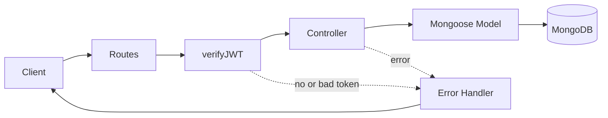

# 📝 Smart Todo


A Todo app with user authentication, built from scratch to practice backend fundamentals: routing, middleware, JWT, cookies and MongoDB relations. Every user sees and edits only their own todos.

> 🚧 **Work in progress.** I'm building this step by step. The checklist below shows exactly what is done.

---

## ✨ Features

| Feature | Status |
|---|---|
| Project setup, MongoDB connection | ✅ Done |
| User registration (validation, duplicate check, bcrypt hashing) | ✅ Done |
| Centralized error handling (`ApiError`, `asyncHandler`) | ✅ Done |
| Login with JWT stored in an HTTP-only cookie | ✅ Done |
| Auth middleware (`verifyJWT`) and `GET /users/me` | ✅ Done |
| Todo CRUD with priority (each user sees only their own todos) | ✅ Done |
| Frontend: todo UI (tabs, priority, completed section) | 🔨 In progress |
| Frontend: login and register forms | ⏳ Planned |
| Logout | ⏳ Planned |
| Input validation and rate limiting | ⏳ Planned |
| Refresh token flow | ⏳ Planned |
| AI feature (break a task into smaller steps) | ⏳ Planned |
| Deployment | ⏳ Planned |

---

## 🔌 API Endpoints

Base URL: `/api/v1`

| Method | Endpoint | Description | Auth | Status |
|---|---|---|---|---|
| POST | `/users/register` | Register a new user | No | ✅ |
| POST | `/users/login` | Login, sets `accessToken` cookie | No | ✅ |
| GET | `/users/me` | Get the logged-in user | Yes | ✅ |
| POST | `/users/logout` | Clear cookie | Yes | ⏳ |
| GET | `/todos` | Get my todos | Yes | ✅ |
| POST | `/todos` | Create a todo | Yes | ✅ |
| PATCH | `/todos/:id` | Toggle complete | Yes | ✅ |
| DELETE | `/todos/:id` | Delete a todo | Yes | ✅ |

**Example: login**

```http
POST /api/v1/users/login
Content-Type: application/json

{
  "email": "aman@test.com",
  "password": "12345678"
}
```

Response (`200 OK`): the user without the password field, plus an HTTP-only `accessToken` cookie.

**Example: create a todo** (needs the cookie from login)

```http
POST /api/v1/todos
Content-Type: application/json

{
  "content": "Revise middleware",
  "priority": "high"
}
```

Response (`201 Created`): the todo, including its `owner`.

**Ownership rule:** a user who tries to read, toggle or delete someone else's todo gets `404`, the same as a todo that does not exist.

---

## 🧭 How a request flows



---

## 🗂️ Project Structure

```
todo-api/
├── public/                  # static frontend
├── src/
│   ├── controllers/         # user and todo logic
│   ├── db/                  # MongoDB connection
│   ├── middlewares/         # auth.middleware.js (verifyJWT)
│   ├── models/              # user.model.js, todo.model.js
│   ├── routes/              # user.routes.js, todo.routes.js
│   ├── utils/               # ApiError, ApiResponse, asyncHandler
│   ├── app.js               # Express app setup
│   ├── constants.js
│   └── index.js             # entry point
├── .env.example
├── .gitignore
└── package.json
```

---

## 🛠️ Tech Stack

- **Node.js** and **Express 5**: server and routing
- **MongoDB** and **Mongoose**: database and schemas
- **bcryptjs**: password hashing
- **jsonwebtoken**: access tokens
- **cookie-parser**: reading cookies
- **dotenv**: environment variables
- **nodemon**: auto-restart in development
- **HTML, CSS, JavaScript**: frontend (`fetch` API)

---

## 🚀 Getting Started

```bash
# 1. Clone
git clone https://github.com/AmanBhardwazzz17/todo-api.git
cd todo-api

# 2. Install dependencies
npm install

# 3. Create your .env file (see below)
cp .env.example .env

# 4. Run in development
npm run dev
```

**.env.example**

```env
PORT=8000
MONGODB_URI=your_mongodb_connection_string
ACCESS_TOKEN_SECRET=your_random_secret
ACCESS_TOKEN_EXPIRY=1d
```

The server starts only after the database connects successfully. Generate a secret with:

```bash
node -e "console.log(require('crypto').randomBytes(32).toString('hex'))"
```

---

## 📚 What I learned building this

- Why the server starts only after the DB connects
- How middleware works and why `next()` matters
- Password hashing with a Mongoose `pre("save")` hook
- Why the token goes in an `httpOnly` cookie
- Protecting routes with `verifyJWT` and attaching the user to `req.user`
- Why `owner` comes from the token and never from the request body
- Correct HTTP status codes (`201`, `400`, `401`, `404`, `409`)
- Tracked vs untracked files in Git, and why secrets never go in a commit

---

## 🗺️ Roadmap

1. Logout and login/register forms on the frontend
2. Validation and rate limiting
3. Refresh token flow
4. AI feature: break a task into smaller steps (API key stays on the backend only)
5. Deploy and set `secure: true` on the cookie

---

## 👤 Author

**Aman Bhardwazz**
BS CS & Data Analytics student at IIT Patna
GitHub: [@AmanBhardwazzz17](https://github.com/AmanBhardwazzz17)